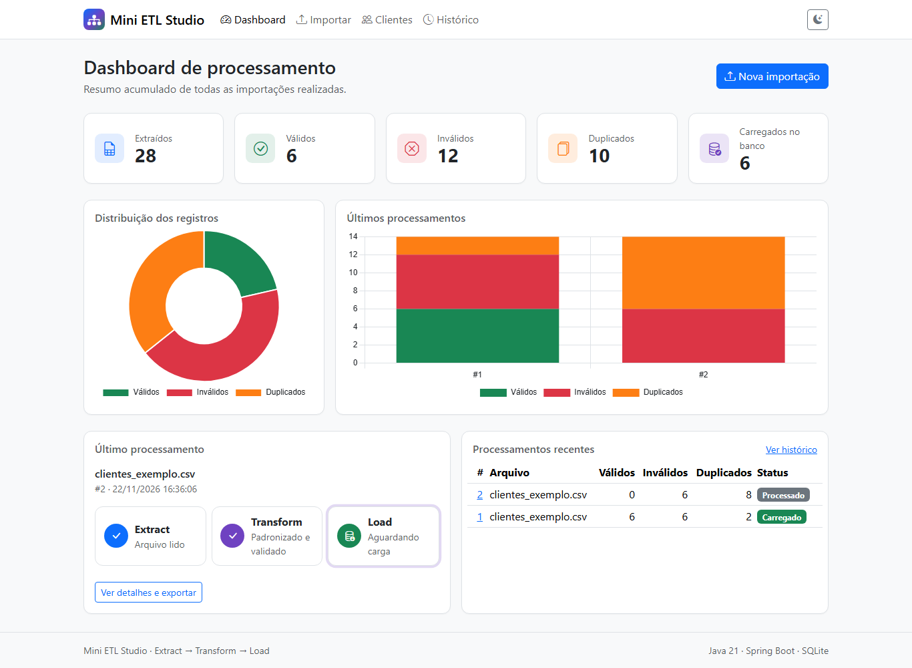
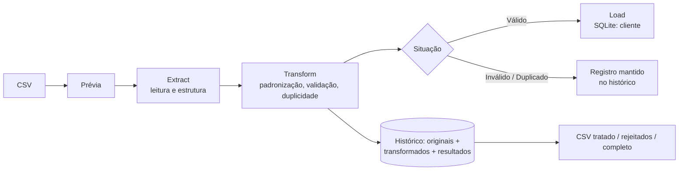
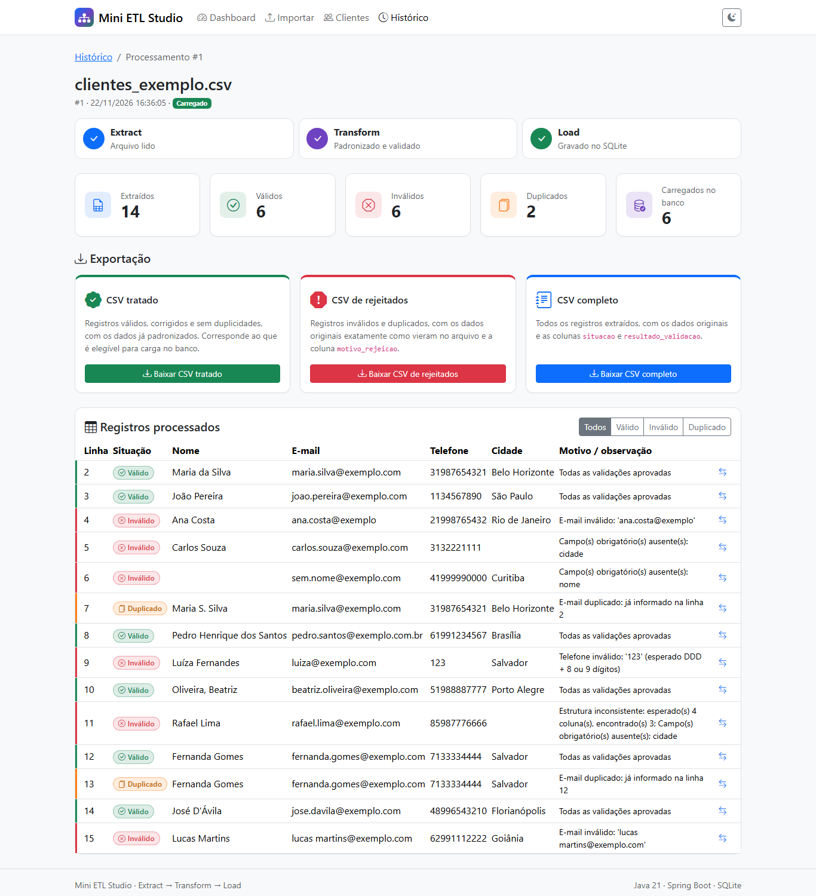
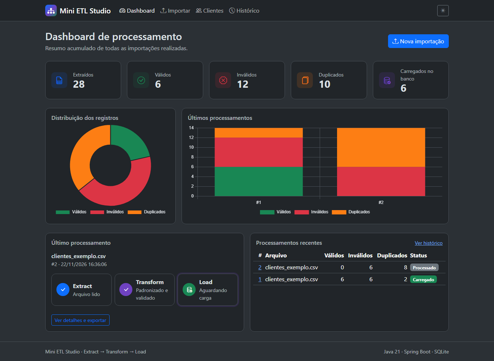
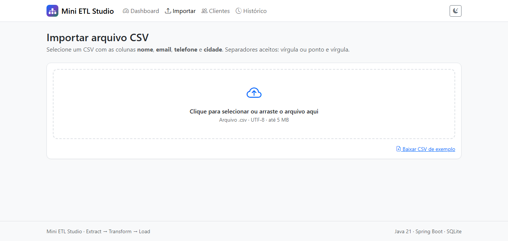
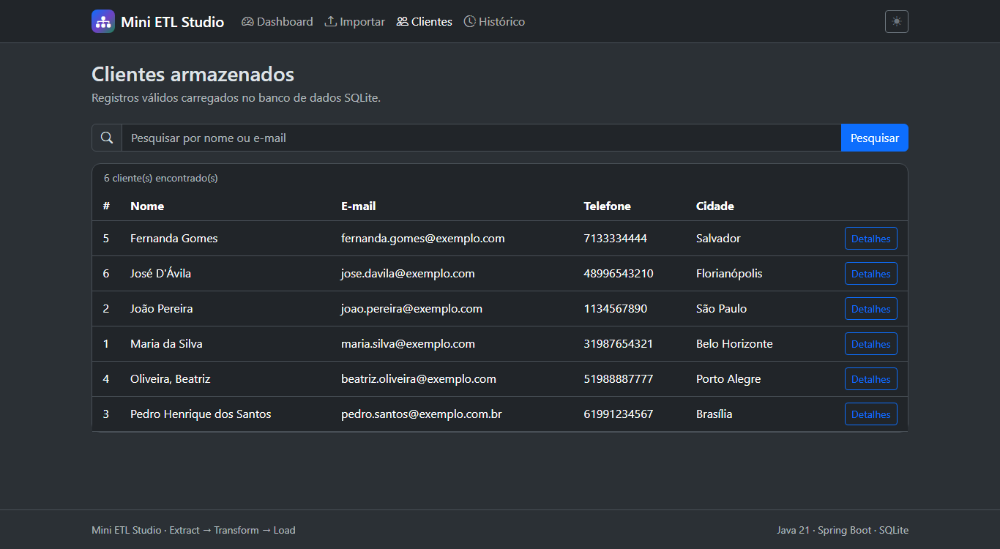
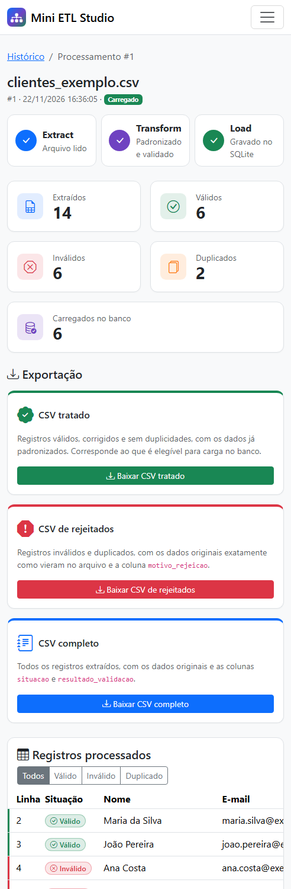

# Mini ETL Studio

Aplicação web para **importar, transformar, validar e carregar** dados de clientes a partir de
arquivos CSV, em um fluxo ETL (Extract, Transform, Load) simples e visual. Os registros válidos
são gravados em **SQLite**. Os inválidos e duplicados ficam disponíveis, com seus motivos, para
exportação, inclusive em importações antigas.

Projeto demonstrativo de engenharia de software com Java 21 e Spring Boot. Ele cobre
arquitetura em camadas, processamento de dados, persistência transacional, testes
automatizados e uma interface responsiva com modo claro e escuro.



## Principais funcionalidades

- **Importação de CSV** com detecção de delimitador (`,` `;` tab) e cabeçalhos flexíveis (`E-mail` = `email`). O arquivo é validado e uma prévia aparece antes do processamento.
- **Extract:** leitura com OpenCSV (RFC 4180) e identificação de linhas com estrutura inconsistente.
- **Transform:** padronização de nomes, e-mails, telefones e cidades. Validação de campos obrigatórios, e-mail e telefone, e **detecção de duplicidade por e-mail**, no arquivo e na base.
- **Classificação** de cada registro como **Válido**, **Inválido** ou **Duplicado**, com todos os motivos.
- **Load:** carga transacional apenas dos válidos, com proteção contra duplicidade e contra recarga.
- **Dashboard** com cards e gráficos (Chart.js).
- **Consulta de clientes** com pesquisa por nome ou e-mail.
- **Histórico** de processamentos, com acesso aos registros de cada um.
- **Três exportações CSV** (UTF-8 com BOM):
  - **CSV tratado:** só os válidos, corrigidos e sem duplicidade.
  - **CSV de rejeitados:** inválidos e duplicados com os **dados originais** e `motivo_rejeicao`.
  - **CSV completo:** todos os registros com `situacao` e `resultado_validacao`.
- **Preservação dos dados originais** de cada registro, separados dos transformados.
- **Interface responsiva** com **modo claro e escuro**. A preferência fica salva no navegador.

## Fluxo ETL



1. **Extract:** o arquivo é lido sem alterar nenhum valor. Cada linha guarda seu número original.
2. **Transform:** os campos são padronizados (`  MARIA da silva ` vira `Maria da Silva`, `+55 (31) 98765-4321` vira `31987654321`) e passam pelas regras de validação e de duplicidade.
3. **Load:** o usuário confirma a carga, e os registros válidos são gravados em uma única transação.

## Telas

| Processamento e exportação | Modo escuro |
|---|---|
|  |  |

| Importação | Clientes (escuro) | Smartphone |
|---|---|---|
|  |  |  |

## Tecnologias

| Camada | Tecnologias |
|---|---|
| Backend | Java 21, Spring Boot 3.3 (Web, Data JPA, Thymeleaf), Hibernate 6 |
| Banco de dados | SQLite (`sqlite-jdbc`, `hibernate-community-dialects`), Flyway, HikariCP |
| CSV | OpenCSV 5.9 |
| Frontend | Thymeleaf, HTMX, Bootstrap 5.3, Bootstrap Icons, Chart.js (via WebJars, sem CDN) |
| Testes | JUnit 5, Mockito, AssertJ, MockMvc, Spring Boot Test |
| Build | Maven |

## Requisitos para execução

- **JDK 21**
- **Maven 3.9+**
- Nenhum banco de dados externo: o SQLite é criado automaticamente.

## Instalação e execução

```bash
git clone https://github.com/ubaldomattos/mini-etl-studio.git
cd mini-etl-studio
mvn spring-boot:run
```

Acesse <http://localhost:8080>. Para testar, baixe o **CSV de exemplo** na tela *Importar*.

Para gerar e executar o JAR:

```bash
mvn clean package
java -jar target/mini-etl-studio-1.0.0.jar
```

Configurações principais, por variáveis de ambiente:

| Variável | Padrão | Descrição |
|---|---|---|
| `APP_DB_PATH` | `./data/mini-etl.db` | Arquivo SQLite |
| `APP_PORT` | `8080` | Porta HTTP |
| `APP_MAX_UPLOAD` | `5MB` | Tamanho máximo do upload |
| `APP_EXPORT_DELIMITER` | `,` | Separador dos CSVs exportados (`;` para Excel em português) |

O passo a passo completo está no [Manual de Instalação](docs/INSTALACAO.md).

## Estrutura do projeto

```
mini-etl-studio/
├── pom.xml
├── docs/                         # documentação técnica e capturas de tela
├── src/main/java/br/com/minietl/
│   ├── config/                   # propriedades e DataSource SQLite
│   ├── domain/                   # entidades, enums e repositórios
│   ├── dto/                      # objetos de visão
│   ├── extract/                  # leitura do CSV (Extract)
│   ├── transform/                # normalizadores, regras, duplicidade (Transform)
│   ├── load/                     # carga transacional (Load)
│   ├── service/                  # orquestração e consultas
│   ├── export/                   # três estratégias de exportação CSV
│   ├── exception/                # exceções de negócio
│   └── web/                      # controllers e tratamento de erros
├── src/main/resources/
│   ├── application.yml
│   ├── db/migration/             # migrações Flyway
│   ├── templates/                # páginas Thymeleaf
│   └── static/                   # CSS, JS e CSV de exemplo
└── src/test/                     # testes e CSVs de teste
```

## Testes

```bash
mvn test
```

A suíte tem **104 testes**, todos usando SQLite real em arquivos temporários:

- leitura de CSV (delimitadores, aspas, quebras de linha, BOM, Windows-1252, arquivos inválidos);
- regras de transformação e validação (nomes, e-mails, telefones, cidades, campos obrigatórios);
- identificação de duplicidades, no arquivo e na base;
- serviço de processamento (com Mockito) e operação de carga, inclusive o rollback transacional;
- persistência com SQLite, incluindo os dados após reiniciar a aplicação;
- geração das três exportações e seus critérios (somente válidos, originais preservados, todas as colunas);
- exportação de processamentos antigos a partir do histórico;
- endpoints web com MockMvc.

## Documentação

- [Requisitos](docs/REQUISITOS.md)
- [Arquitetura](docs/ARQUITETURA.md)
- [Manual de Instalação](docs/INSTALACAO.md)
- [Manual do Usuário](docs/MANUAL_USUARIO.md)

## Licença

Distribuído sob a [licença MIT](LICENSE).
