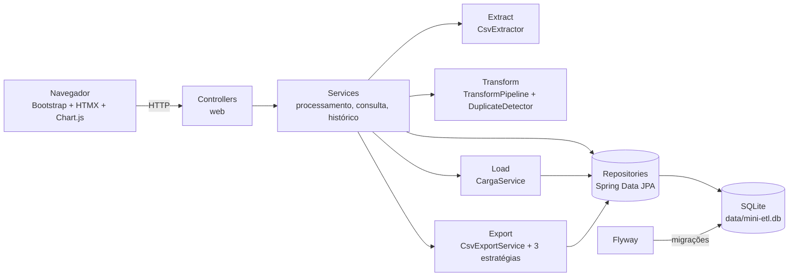
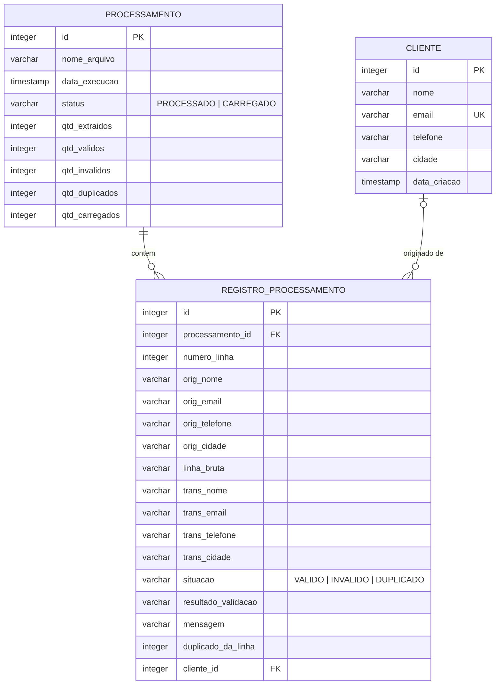
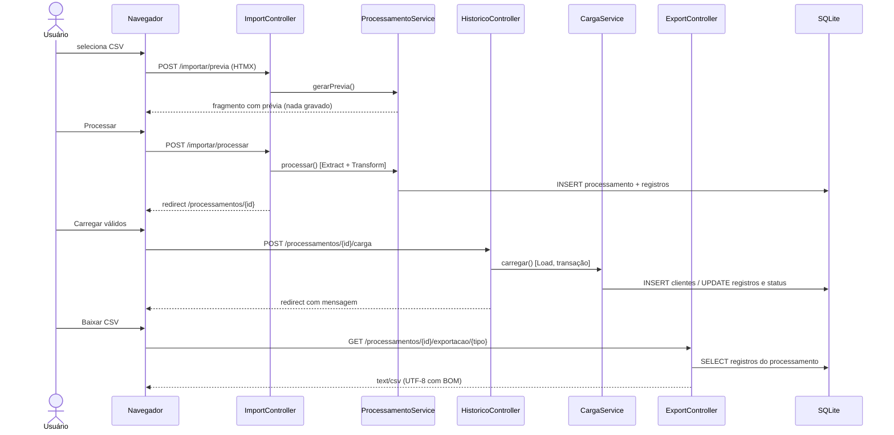
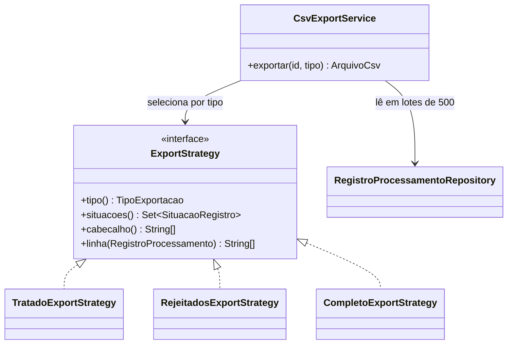

# Documento de Arquitetura — Mini ETL Studio

## 1. Visão geral

O Mini ETL Studio é um **monólito em camadas** com Spring Boot. O servidor renderiza as
páginas com Thymeleaf, e o HTMX faz atualizações parciais pontuais, como a prévia do upload e a
pesquisa de clientes. O banco é um arquivo SQLite local. O processamento é síncrono e roda
inteiro em memória, o que basta para arquivos de pequeno porte.



## 2. Tecnologias e justificativas

| Tecnologia | Uso | Justificativa |
|---|---|---|
| Java 21 | Linguagem | Versão LTS exigida. O projeto usa records, `switch` com expressões e text blocks. |
| Spring Boot 3.3 | Framework | Configuração automática, injeção de dependência, MVC e transações. |
| Spring Data JPA / Hibernate 6 | Persistência | Repositórios declarativos e mapeamento objeto-relacional. |
| `sqlite-jdbc` + `hibernate-community-dialects` | Banco | O SQLite dispensa instalação. O dialeto oficial do SQLite para Hibernate 6 fica no módulo *community*. |
| Flyway | Versionamento do esquema | O esquema é criado na primeira execução, e evoluções futuras entram como novas migrações (`V2__...sql`). |
| HikariCP (pool = 1) | Conexões | O SQLite aceita um escritor por vez. Com WAL e `busy_timeout`, o app evita erros de bloqueio. |
| OpenCSV (RFC 4180) | Leitura e escrita de CSV | Trata aspas, delimitadores e quebras de linha corretamente, sem manipulação manual. |
| Thymeleaf | Front-end (SSR) | Tudo roda no mesmo build Maven, sem Node nem etapa de build separada. É simples de manter. |
| HTMX | Interações parciais | Atualiza a prévia e a pesquisa sem SPA e quase sem JavaScript próprio. |
| Bootstrap 5.3 + Bootstrap Icons | Layout e componentes | Grid responsivo e modo escuro nativo (`data-bs-theme`). |
| Chart.js | Gráficos | Gráficos simples (rosca e barras) sem dependências adicionais. |
| WebJars | Empacotamento do front-end | As bibliotecas vêm dentro do JAR. O app funciona sem internet e sem CDN. |
| JUnit 5, Mockito, AssertJ, MockMvc | Testes | Padrão do ecossistema Spring. |

## 3. Organização dos pacotes

```
br.com.minietl
├── MiniEtlStudioApplication      # ponto de entrada
├── config/                       # AppProperties (app.*), DataSourceConfig (SQLite)
├── domain/
│   ├── entity/                   # Cliente, Processamento, RegistroProcessamento
│   ├── enums/                    # SituacaoRegistro, StatusProcessamento
│   └── repository/               # repositórios Spring Data
├── dto/                          # objetos de visão (records) usados pelos templates
├── extract/                      # CsvExtractor, RegistroExtraido, ExtracaoResultado
├── transform/
│   ├── normalizer/               # Nome, Email, Telefone, Cidade + TextoUtil
│   ├── rule/                     # ValidationRule e implementações
│   ├── TransformPipeline         # padroniza + valida
│   ├── DuplicateDetector         # duplicidade por e-mail
│   └── ResultadoValidacaoFormatter
├── load/                         # CargaService (transacional)
├── service/                      # ProcessamentoService, ClienteService, HistoricoService, DashboardService
├── export/                       # CsvExportService, ExportStrategy x3, TipoExportacao
├── exception/                    # exceções de negócio
└── web/                          # controllers + GlobalExceptionHandler
```

A dependência entre pacotes segue um único sentido: `web → service/load/export → extract/transform → domain`.
As regras de ETL (`extract`, `transform`) não conhecem nem controllers nem JPA.

## 4. Responsabilidades das principais classes

| Classe | Responsabilidade |
|---|---|
| `CsvExtractor` | Decodifica o arquivo (UTF-8, com fallback para Windows-1252) e remove o BOM. Detecta o delimitador, mapeia os cabeçalhos para as colunas obrigatórias, rejeita arquivos inválidos e gera `RegistroExtraido` com os valores **intactos** e eventuais problemas de estrutura. |
| `NomeNormalizer`, `EmailNormalizer`, `TelefoneNormalizer`, `CidadeNormalizer` | Uma regra de padronização por campo. Cada uma é testável isoladamente. |
| `ValidationRule` (interface) | Contrato das validações. As implementações são `EstruturaRule`, `CamposObrigatoriosRule`, `EmailFormatoRule` e `TelefoneFormatoRule`. Para criar uma regra nova, basta adicionar um `@Component` (princípio aberto/fechado). |
| `TransformPipeline` | Aplica os normalizadores e todas as regras. Gera um `RegistroAvaliado` com original, transformado, situação e resultado de cada regra. |
| `DuplicateDetector` | Marca como duplicados os registros válidos cujo e-mail repete no arquivo ou já existe na base. |
| `ResultadoValidacaoFormatter` | Monta os textos de `resultado_validacao` e de motivo de rejeição. |
| `ProcessamentoService` | Orquestra Extract e Transform. Persiste o `Processamento` e os `RegistroProcessamento` em uma transação. Também gera a prévia, sem gravar nada. |
| `CargaService` | Etapa Load, em transação. Grava os válidos como `Cliente`, revalida a duplicidade contra a base, vincula cada registro ao cliente criado e atualiza o status. |
| `CsvExportService` | Gera o CSV em memória (UTF-8 com BOM) a partir dos registros do processamento, com a estratégia do tipo pedido. |
| `TratadoExportStrategy`, `RejeitadosExportStrategy`, `CompletoExportStrategy` | Cada uma define quais situações entram no arquivo, o cabeçalho e o mapeamento de cada linha. |
| `GlobalExceptionHandler` | Converte exceções em página de erro ou em fragmento HTMX, com o status HTTP adequado. Registra no log os erros inesperados. |

## 5. Modelo de dados



- `processamento` é o histórico, com uma linha por importação.
- `registro_processamento` guarda uma linha por registro extraído. Mantém os dados **originais** (`orig_*` e `linha_bruta`), os **transformados** (`trans_*`), a situação, o resultado de cada validação (`resultado_validacao`), os motivos (`mensagem`), a linha de origem da duplicidade e o cliente gerado na carga.
- `cliente` guarda apenas registros válidos carregados. O índice único em `email` protege contra duplicidade.
- Índices: `(processamento_id, numero_linha)` e `(processamento_id, situacao)` para consultas e exportações. Índice em `data_execucao` para o histórico.
- O esquema está em `src/main/resources/db/migration/V1__criar_esquema.sql`. O Hibernate não altera o esquema (`ddl-auto=none`).

## 6. Fluxo de comunicação



### Rotas

| Método e rota | Descrição |
|---|---|
| `GET /` | Dashboard |
| `GET /importar` | Tela de upload |
| `POST /importar/previa` | Prévia, devolvida como fragmento HTMX |
| `POST /importar/processar` | Extract e Transform, depois redireciona ao detalhe |
| `GET /processamentos` | Histórico |
| `GET /processamentos/{id}?situacao=&pagina=` | Detalhe e registros |
| `POST /processamentos/{id}/carga` | Load |
| `GET /processamentos/{id}/exportacao/{tratado\|rejeitados\|completo}` | Download do CSV |
| `GET /clientes?q=&pagina=` | Consulta de clientes, com fragmento HTMX na pesquisa |
| `GET /clientes/{id}` | Detalhe do cliente |
| `GET /exemplo/clientes_exemplo.csv` | Arquivo de exemplo |

## 7. Etapas ETL

### Extract

1. Rejeita arquivos vazios, binários (com bytes nulos) ou sem extensão `.csv`.
2. Decodifica o texto como UTF-8. Se falhar, usa Windows-1252 e emite um aviso.
3. Detecta o delimitador pela frequência de `,`, `;` e tab na primeira linha, fora de aspas.
4. Localiza as colunas obrigatórias pelo nome normalizado, aceitando qualquer ordem e grafias como `E-mail`.
5. Converte cada linha em `RegistroExtraido`, sem trim nem qualquer alteração. Registra o número da linha física, a linha bruta e o problema de estrutura, se houver.

### Transform

1. **Padronização** pelos normalizadores: espaços (inclusive NBSP e caracteres invisíveis), Title Case, minúsculas no e-mail e só dígitos no telefone, sem o DDI 55.
2. **Validação** por todas as `ValidationRule`. Cada uma retorna `APROVADA`, `REPROVADA` (com mensagem) ou `NAO_APLICAVEL`. Todas as regras rodam, para que todos os motivos fiquem registrados.
3. **Duplicidade** (`DuplicateDetector`): considera apenas os válidos e usa o e-mail padronizado. O primeiro registro fica, os seguintes viram `DUPLICADO` com a linha de origem. E-mails já presentes na base também viram `DUPLICADO`.

### Load

1. Bloqueia processamentos já carregados (`OperacaoInvalidaException`).
2. Consulta de novo os e-mails na base, porque outro processamento pode ter sido carregado nesse meio-tempo. Os registros afetados são reclassificados como `DUPLICADO`.
3. Insere os clientes, vincula cada `RegistroProcessamento` ao seu `cliente_id`, grava `qtd_carregados` e muda o status para `CARREGADO`.
4. Tudo roda em uma transação `@Transactional`. Qualquer `DataAccessException` vira `CargaException`, a transação é revertida e nenhum registro fica gravado.

## 8. Preservação dos dados originais e transformados

- Os valores originais entram em `RegistroExtraido`, um record imutável, e seguem com o registro até a persistência. Nenhum normalizador altera esse objeto: cada um gera novos valores em `CamposPadronizados`.
- Na persistência, os originais vão para `orig_*` e `linha_bruta`, e os transformados para `trans_*`. Um campo transformado vazio é gravado como `NULL`.
- Os originais nunca são atualizados depois da extração. A única atualização posterior, feita na carga, altera `situacao`, `resultado_validacao`, `mensagem` e `cliente_id`.
- Assim, as três exportações podem ser reconstruídas a qualquer momento, inclusive depois de reiniciar a aplicação, sem o arquivo original.

## 9. Arquitetura das exportações



- O padrão *Strategy* separa **o que** exportar, definido na estratégia, de **como** escrever, definido no serviço (OpenCSV, BOM, delimitador, fim de linha CRLF e valores nulos como vazio).
- A leitura é paginada (`Slice`, 500 por lote), ordenada por número de linha.
- O arquivo é gerado em memória e devolvido com `Content-Disposition: attachment`, sem gravação em disco.
- O delimitador é configurável por `app.export.delimiter`.

## 10. Decisões arquiteturais

| Decisão | Motivo | Alternativa descartada |
|---|---|---|
| Fluxo em três passos (prévia, processar, carregar) | O usuário revisa os dados antes da carga e pode exportar sem carregar. | Processar e carregar em um único clique. |
| Persistir todos os registros do processamento | Exportar rejeitados e o processamento completo a partir do histórico. | Guardar só contagens ou o CSV original. |
| Colunas `orig_*` e `trans_*` separadas, em vez de JSON | Consultas e mapeamento simples, e o esquema fica explícito. | Colunas JSON. |
| Duplicidade avaliada só entre válidos | Um registro inválido não pode impedir que um válido seja carregado. | Comparar todos os registros. |
| Revalidação da duplicidade na carga | Evita violar o índice único quando processamentos são carregados fora de ordem. | Falhar a carga inteira. |
| Thymeleaf + HTMX em vez de SPA | Um build só, menos código e manutenção simples. | React ou Angular. |
| Flyway com `ddl-auto=none` | Esquema versionado e previsível. | `ddl-auto=update`. |
| Pool de conexões de tamanho 1 | Limitação de escrita do SQLite. | Pool padrão (10). |

## 11. Possíveis evoluções

- Mapeamento de colunas configurável pelo usuário, para cabeçalhos com outros nomes.
- Novas regras de validação, como cidade em uma lista de municípios do IBGE. Basta um novo `ValidationRule`.
- Processamento assíncrono com barra de progresso para arquivos grandes.
- Exclusão e reprocessamento de importações.
- Autenticação e trilha de auditoria por usuário.
- API REST (JSON) para integração com outros sistemas.
- Troca do SQLite por PostgreSQL, alterando apenas o DataSource, o dialeto e as migrações.
